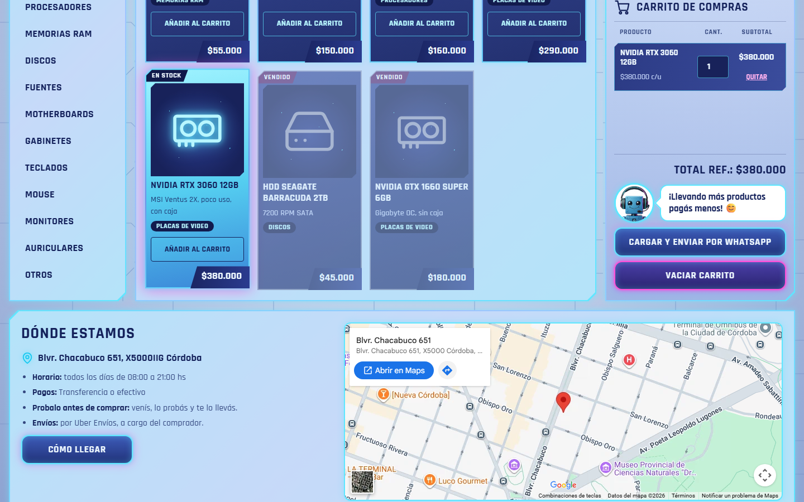
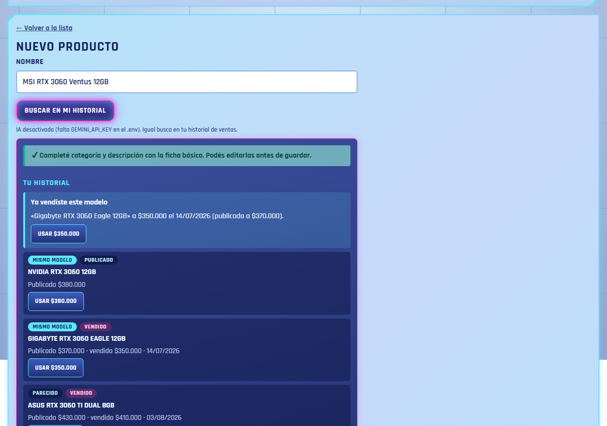

# GGaming

Tienda web de hardware de PC usado, con panel de administración, asistente de IA y bot de WhatsApp.
Los clientes arman su pedido en la web y lo envían por WhatsApp; el dueño carga productos desde el
celular y la IA le sugiere categoría, descripción y precio a partir de su propio historial de ventas.

**Demo:** _(agregar la URL de producción)_

| Tienda | Celular | Panel admin con IA |
|---|---|---|
|  |  |  |

## Funcionalidades

**Tienda (pública)**
- Catálogo con búsqueda y filtro por categoría, diseño responsive mobile-first estilo HUD gaming.
- Carrito en el navegador y pedido por WhatsApp con el detalle y total referencial.
- Sección "Dónde estamos" con Google Maps y botón "Cómo llegar".

**Panel admin (con login)**
- Alta, edición y baja de productos; subida de varias fotos desde el celular (se enderezan según EXIF,
  se redimensionan y se comprimen; se eliminan metadatos como la ubicación GPS).
- **Memoria de precios:** historial de ventas y búsqueda de modelos iguales o parecidos
  (algoritmo propio de similitud: distingue "RTX 3060" de "RTX 3060 Ti" o "Ryzen 5600" de "5600X").
- **Asistente con IA (Gemini):** sugiere categoría, descripción y precio; chat que responde sobre el
  stock y las ventas. Con respaldo automático a otro modelo si se agota la cuota y caché de respuestas.
- **Ficha sin IA:** clasificador por reglas y expresiones regulares que completa categoría y descripción
  aunque la IA no esté disponible.

**Bot de WhatsApp (WhatsApp Cloud API de Meta)**
- Responde 24 hs con el stock y precios reales, agenda visitas validando el horario y deriva al dueño
  lo que no puede resolver (descuentos, envíos, reclamos), avisándole por WhatsApp.
- Simulador en el panel admin para probarlo sin conectar Meta.

## Stack

| Capa | Tecnología |
|---|---|
| Backend | Java 25, Spring Boot 3.5 (Web MVC, Security, Validation, JDBC) |
| Vistas | Thymeleaf, CSS propio (mobile-first), JavaScript sin frameworks |
| Base de datos | SQLite |
| IA | Google Gemini API (salida estructurada en JSON) |
| Integraciones | WhatsApp Cloud API (webhook con firma HMAC), Google Maps |
| Imágenes | ImageIO + TwelveMonkeys (WEBP/JPEG), metadata-extractor (EXIF) |
| Tests | JUnit 5, AssertJ, Mockito (+ pruebas de punta a punta con Puppeteer) |
| Infra | Docker, Docker Compose, Caddy (HTTPS automático), GitHub Actions, Dependabot |

## Arquitectura

Aplicación en capas: cada paquete tiene una sola responsabilidad.

```
Navegador / Meta ──▶ controller ──▶ service ──▶ repository ──▶ SQLite
                         │              │
                         │              ├──▶ ia   (AsistenteIa → Gemini)
                         │              └──▶ bot  (AgenteBot → Gemini, Mensajero → WhatsApp)
                       config  (seguridad, cabeceras, límites)
```

La IA está detrás de interfaces (`AsistenteIa`, `AgenteBot`, patrón Strategy): cambiar de proveedor
no toca el resto del código. La IA **propone** y el código **valida** (por ejemplo, un turno fuera de
horario se rechaza aunque la IA lo acepte).

## Seguridad

- Spring Security: login con BCrypt, protección CSRF, sesión con cookies `HttpOnly` y `SameSite`.
- Bloqueo por fuerza bruta (por IP y global) y límite de pedidos por IP (HTTP 429).
- Cabeceras: Content-Security-Policy estricta, `X-Frame-Options`, `nosniff`, HSTS en HTTPS.
- Consultas SQL parametrizadas, salida escapada (anti-XSS), validación de imágenes subidas
  (tamaño, resolución máxima, re-codificación).
- Webhook de WhatsApp validado con firma HMAC-SHA256 de Meta.
- En producción la app no arranca con contraseñas o claves débiles.
- Contenedor sin root, con sistema de archivos de solo lectura y sin capacidades extra.
- Dependencias revisadas contra la base de vulnerabilidades OSV y Dependabot activado.

## Correr en local

Requisitos: Java 25.

```bash
cp .env.example .env          # completar GEMINI_API_KEY si querés la IA
./mvnw spring-boot:run        # en Windows: .\mvnw.cmd spring-boot:run
```

- Tienda: http://localhost:8080
- Admin: http://localhost:8080/admin (usuario y contraseña de `ADMIN_USER` / `ADMIN_PASSWORD`, por defecto `admin` / `admin` solo en local)

Tests: `./mvnw test`

## Producción

Guía paso a paso (servidor gratuito en Oracle Cloud, dominio, HTTPS y backups): [docs/DEPLOY.md](docs/DEPLOY.md).
